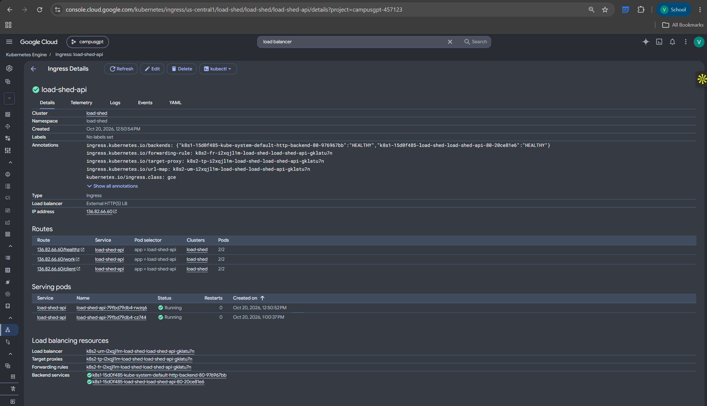
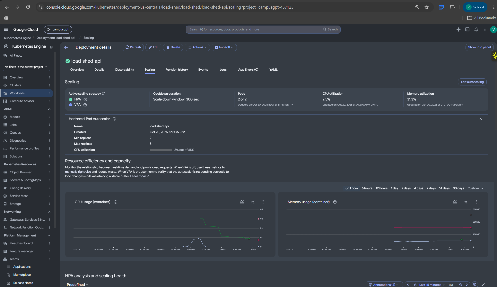
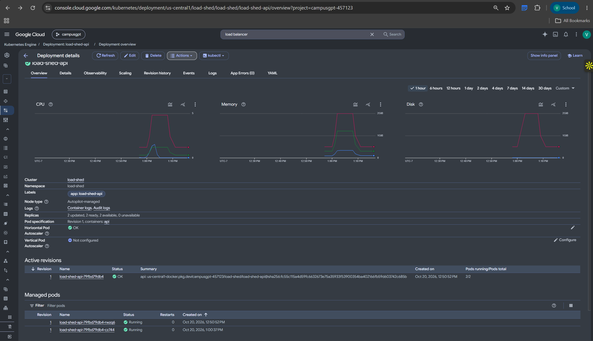
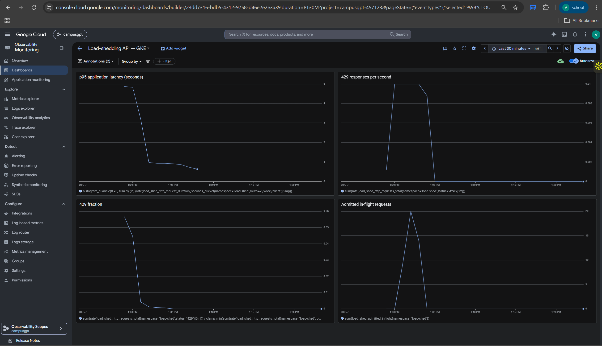
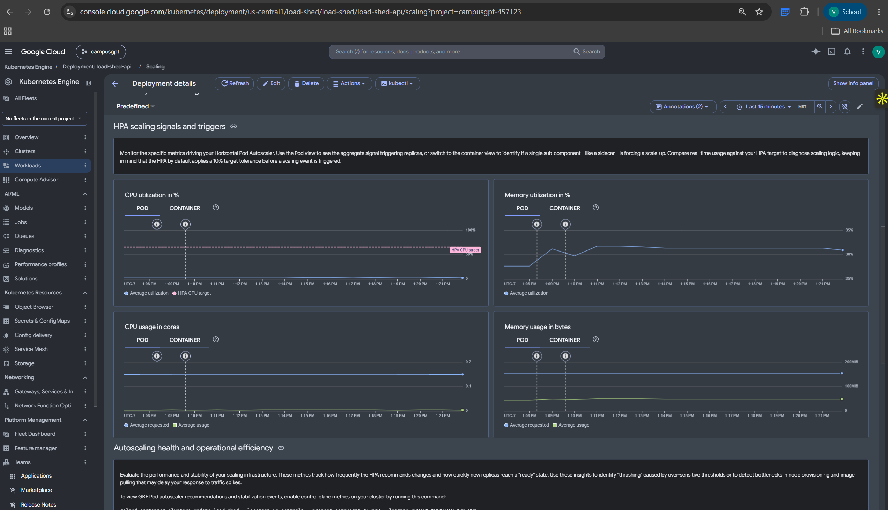

# GKE deployment evidence

Verified on October 20, 2026 in project `campusgpt-457123`, regional GKE Autopilot
cluster `load-shed` in `us-central1`. These are original user-captured Cloud Console
screenshots. Open each image to inspect the full resolution.

## Cloud Load Balancing

The GKE Ingress shows healthy backends, an external HTTP(S) load balancer,
public routes for `/healthz`, `/work` and `/client`, and two running serving pods.
This demonstration serves HTTP; no TLS certificate was configured.

## Horizontal Pod Autoscaler

The HPA has a minimum of 2 and maximum of 8 replicas, a CPU target of 65%, and a
300-second scale-down stabilization window. This capture shows the service back
at two pods after the load experiment. The configured maximum alone does not
prove that eight pods ran: the recorded experiment samples in
[deployment-evidence.json](deployment-evidence.json) show the observed 2 -> 4 -> 8 scaling.

## Deployment and Artifact Registry

The deployment shows two Ready API pods, a healthy HPA, and an active revision
using an Artifact Registry image pinned by SHA-256 digest. CPU and memory history
show the load experiment followed by reduced resource requests after scale-down.

## Cloud Monitoring dashboard

The application dashboard shows p95 request latency, HTTP 429 responses per second,
429 fraction, and admitted in-flight requests from the live Prometheus metrics.
The time window includes the load and protection experiments. These are mixed
experiments, so the latency curve is not an isolated autoscaling benchmark.

Additional CPU and memory monitoring capture

This later window shows the service idle after the experiment; it does not show
the peak scaling interval.

## Behavioral verification

The [machine-readable evidence](deployment-evidence.json) records:

- 10 passing tests in the Linux container.
- Public smoke requests returning 200 for health, work, and dependency calls.
- A 250-request burst: 73 successes and 177 HTTP 429 responses, all checked for `Retry-After: 1`.
- Priority admission ceilings and counter reconciliation, including 50 maximum in-flight requests.
- Five dependency failures returning 502, an open breaker returning 503, recovery after cooldown returning 200, and a timeout returning 504.
- Actual HPA scaling from 2 to 4 to 8 replicas.
- Nonempty Cloud Monitoring PromQL results for application latency and HTTP 429 rate.

The CPU scaling experiment recorded 5,145 successes and 11 HTTP 502 responses
(approximately 0.21%); the cause of those errors was not isolated. These captures
and measurements document the deployment at the recorded time and do not imply
that the endpoint is permanently hosted. See [the deployment guide](gke.md) to
recreate or remove the infrastructure.
